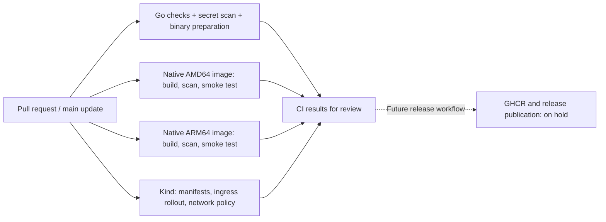

# Continuous integration

CI validates source changes and a disposable local deployment. Registry
publication is deliberately excluded while GHCR visibility is undecided.

## Check flow

## Checks

| Workflow | Purpose |
|---|---|
| [CI](../.github/workflows/ci.yml) | Go checks, secret scanning, native AMD64/ARM64 image builds, vulnerability gates, container smoke checks, and binary archive preparation |
| [Integration](../.github/workflows/integration.yml) | Build the native image, create a disposable Kind cluster with Calico and Traefik, deploy the app, and verify HTTP rollout availability and network isolation |

Both workflows run on pull requests and changes to `main`. The jobs use
read-only repository permissions and pinned action commits. Tokens for the
test application are generated during the run and are not production credentials.
No registry credentials are needed.

Container vulnerability checks fail on HIGH/CRITICAL findings. Failure blocks a
successful CI result; publication cannot be considered protected until a release
workflow depends on these checks. Branch protection is separate repository
configuration and has not been enabled by these files.

## Deployment boundary

The integration job deploys into its own ephemeral Kind cluster. It does not
connect to the workstation cluster, EKS, or a persistent production environment.
The cluster uses real ingress and an enforcing CNI so policy checks test behavior,
not only accepted YAML. Failure diagnostics exclude Secrets and credential files.

## Publication boundary

This phase does not authenticate to GHCR, push container images, upload container
archives, create version tags, or publish GitHub Releases. Binary archives and
checksums are prepared and checked in the job workspace only.

After the visibility decision, release work must:

1. Validate the version tag and source revision.
2. Require successful tests and security gates for both architectures.
3. Publish the approved image index and binary release assets.
4. Record immutable digests and verify pulls using the selected access model.
5. Validate new-version rollout and rollback before marking deployment successful.

## Evidence

Executed checks and known limits belong in [the validation report](../VALIDATION.md).
The first hosted CI and integration runs passed; direct links and rollout metrics
are recorded in that report. Workflow files alone are not execution evidence. The next review
and release tasks are in [tomorrow’s checklist](TOMORROW.md).
