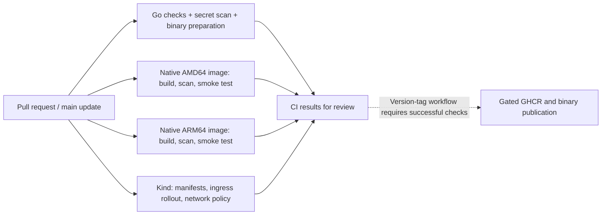

# Continuous integration

CI validates source changes and a disposable local deployment. A separate
version-tag release workflow handles approved public GHCR and binary publication.

## Check flow

## Checks

| Workflow | Purpose |
|---|---|
| [CI](../.github/workflows/ci.yml) | Go checks, secret scanning, native AMD64/ARM64 image builds, vulnerability gates, container smoke checks, and binary archive preparation |
| [Integration](../.github/workflows/integration.yml) | Build the native image, create a disposable Kind cluster with Calico and Traefik, deploy the app, and verify HTTP rollout availability and network isolation |

Both workflows run on pull requests and changes to `main`. The jobs use
read-only repository permissions and pinned action commits. Tokens for the
test application are generated during the run and are not production credentials.
No registry credentials are needed.

Container vulnerability checks fail on HIGH/CRITICAL findings. Failure blocks a
successful CI result; publication cannot be considered protected until a release
workflow depends on these checks. Branch protection is separate repository
configuration and has not been enabled by these files.

## Deployment boundary

The integration job deploys into its own ephemeral Kind cluster. It does not
connect to the workstation cluster, EKS, or a persistent production environment.
The cluster uses real ingress and an enforcing CNI so policy checks test behavior,
not only accepted YAML. Failure diagnostics exclude Secrets and credential files.

## Publication boundary

Pull-request validation does not publish images, tags, or GitHub Releases. The
separate release workflow requires a strict version tag from `main`, repeats the
required CI and deployment gates, and scans the actual release outputs before
publishing. Only the publication job receives package/release write permissions.

Public images are owned by `LiatSchulz` and stored at
`ghcr.io/liatschulz/echo-pong`. Publication uses the workflow's short-lived
`GITHUB_TOKEN`; no personal publishing token is stored in the repository.
[Release details](RELEASES.md) describe versions, immutable deployment digests,
access, and cleanup scope. Actual publication remains unverified until a tagged
run succeeds and the package is publicly pullable.

## Evidence

Executed checks and known limits belong in [the validation report](../VALIDATION.md).
The first hosted CI and integration runs passed; direct links and rollout metrics
are recorded in that report. Workflow files alone are not execution evidence. The next review
and release tasks are in [tomorrow’s checklist](TOMORROW.md).
