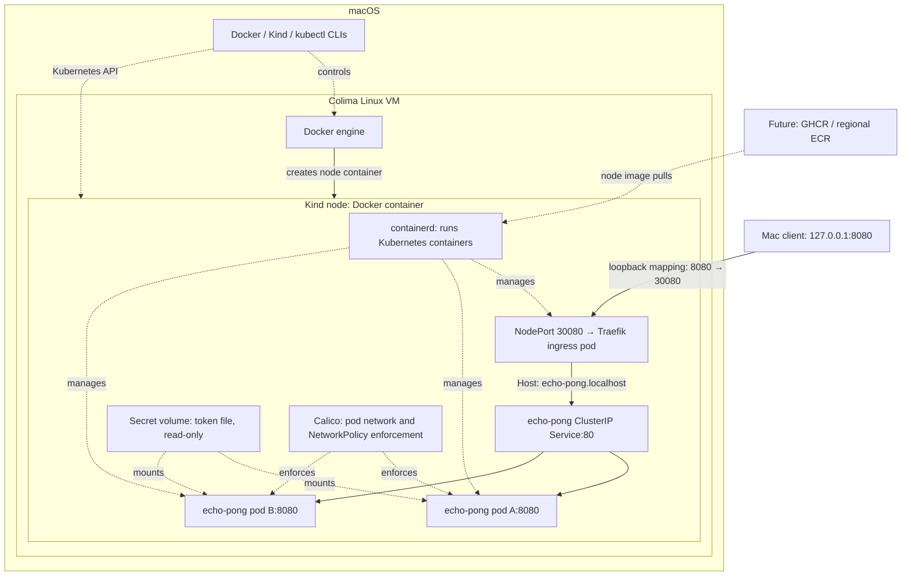

# Echo-Pong presentation guide

A 7–10 minute walkthrough of the local deployment, its evidence, and the path to
production. Run demo commands from the repository root. Setup instructions live
in [the Kubernetes guide](../k8s/README.md); recorded results live in
[the validation report](../VALIDATION.md).

## 1. State the outcome — 30 seconds

“The application runs behind an ingress controller with two replicas, restricted
containers, mounted authentication credentials, and enforced network isolation.
Both CPU architectures have been built and tested. I verified rolling restart
availability through ingress and tested that the network restrictions actually
block traffic. Release automation is the next integration step.”

| Demonstrated locally | Still to implement or validate |
| --- | --- |
| Linux ARM64 and AMD64 images and HTTP/CLI smoke tests | GitHub Actions and release gates |
| Non-root, read-only runtime with dropped capabilities | GHCR publication, binary releases, production digest promotion |
| Trivy scans with zero HIGH/CRITICAL findings at validation time | Continuous rescanning as vulnerability data changes |
| Ingress rolling restart: 1,106 requests, zero observed failures | New-version release rollout and rollback automation |
| Positive and negative network controls | Multi-node failure recovery, load tests, cloud deployment |

AMD64 runtime checks used emulation on this ARM64 Mac. A successful scan is a
dated observation, not a permanent statement about an image's vulnerabilities.

## 2. Explain where everything runs — 90 seconds



- Colima provides the Linux VM needed to run Linux containers on macOS.
- Kind creates a Kubernetes node as a Docker container. Inside that node,
  containerd runs the pod containers; the app is not a standalone Mac process.
- Only the proxy is exposed through the loopback port mapping. The application
  Service stays ClusterIP; it has no public listener or NodePort of its own.
- Calico enforces ingress from the designated Traefik pods and denies all app
  egress, including DNS. This app has no outbound dependencies.
- Image pulls are node operations. Denying app-pod egress does not prevent the
  node from pulling an image; node registry connectivity and credentials remain
  separate requirements. Local images are loaded into Kind and use pull policy
  `Never`.

## 3. Show the running system — 2 minutes

These commands inspect the existing local deployment without revealing its
token. They assume Colima, the cluster, and the app are already running.

```sh
colima status
docker ps --filter name=echo-pong-control-plane
kubectl --context kind-echo-pong get nodes -o wide
kubectl --context kind-echo-pong -n echo-pong get deploy,pods,svc,ingress,pdb,networkpolicy

# Public health works through the real ingress path.
curl --fail -H 'Host: echo-pong.localhost' http://127.0.0.1:8080/health

# Protected endpoint rejects missing credentials: expect HTTP 401.
curl -sS -o /dev/null -w 'HTTP %{http_code}\n' \
  -H 'Host: echo-pong.localhost' http://127.0.0.1:8080/ping

# Supply the ignored local token through stdin, not command arguments or output.
{ printf 'Authorization: Bearer '; tr -d '\n' < secrets/token; printf '\n'; } |
  curl --fail --header @- -H 'Host: echo-pong.localhost' \
    http://127.0.0.1:8080/ping

kubectl --context kind-echo-pong -n echo-pong get deployment echo-pong \
  -o jsonpath='{.spec.template.spec.securityContext}{"\n"}{.spec.template.spec.containers[0].securityContext}{"\n"}'
```

Explain the security settings: UID/GID 65532, read-only root filesystem, no Linux
capabilities, no privilege escalation, default seccomp, and no mounted Kubernetes
API token. The authentication token is a separate group-readable Secret volume,
not an image layer or a tracked file. The app reads it at startup, so rotation
requires a coordinated restart; overlapping old/new replicas can accept different
tokens during rotation.

## 4. Demonstrate availability and isolation — 2 minutes

Use the recorded validation results for a short demo. Optionally rerun these
checks if time permits. They mutate the local cluster: the first restarts app pods; the second
temporarily creates diagnostic resources and an allow-policy control, then cleans
them up. Neither is intended to target a production cluster.

```sh
python3 scripts/check-rollout.py --url http://127.0.0.1:8080
scripts/verify-network.sh
```

The rollout check sends authenticated requests through Traefik while restarting
the Deployment. It reports observed failures rather than relying on pod status.
The network check first proves its client/destination can communicate, then
checks rejection after policy enforcement. Its egress test uses an actual app
pod's network namespace; testing an unrelated pod would not prove app isolation.

Explain the rollout settings together:

| Setting | Reason |
| --- | --- |
| Two replicas; `maxUnavailable: 0`, `maxSurge: 1` | Keep existing capacity until a replacement is ready; requires spare resources |
| Startup probe: up to 60 seconds | Preserve the intentional 10-second startup without premature liveness restarts |
| Readiness probe; `minReadySeconds: 5` | Send traffic to ready pods and require a short stable period before rollout advances |
| Kubelet preStop sleep: 10 seconds | Allow endpoint/proxy updates to propagate while the old process still serves |
| SIGTERM drain: up to 20 seconds; grace: 40 seconds | Finish active requests after the preStop delay with room before forced termination |
| Header/read/write/idle timeouts: 5/10/15/60 seconds | Bound slow clients and idle connections |
| Disruption budget | Limit voluntary disruptions; it does not guarantee survival of a node failure |

The Go change is deliberately small: default signal termination could cut off
active requests, so the server now handles SIGTERM/SIGINT and waits for HTTP
shutdown. Race-enabled tests cover actual in-flight request completion and forced
connection closure when the drain deadline expires; vet also passes.

## 5. Explain the image and release design — 1 minute

The builder runs on its native CPU and cross-compiles static Go binaries with
`CGO_ENABLED=0` for Linux AMD64 and ARM64. The compiler image is pinned by digest.
The final scratch image contains the binary, with no shell, package manager, or
runtime libraries. An allowlist in `.dockerignore` keeps credentials and local
files out of the build context. A minimal image still contains Go standard-library
code, so compiler updates and binary vulnerability scanning matter.

The next pipeline should validate pull requests without publishing releases. A
version-tag workflow should build both architectures, scan each, block promotion
on HIGH/CRITICAL findings, publish one multi-platform image index to GHCR, and
attach versioned binary archives and checksums to a GitHub Release. Production
should deploy the approved index digest so each node chooses its architecture
without tags moving underneath the deployment. This workflow is **planned**, not
implemented yet.

Public GHCR publication is the chosen approach, so nodes can pull anonymously.
A private package would protect access to proprietary images, but needs read-only
registry credentials provisioned as an image-pull Secret, referenced by the
service account, and rotated. The app authentication Secret is separate.

## 6. Handle likely follow-up questions — 1–2 minutes

**How would you scale?** The server is stateless, so add replicas behind the same
Service. Use measured resource requests and an HPA once metrics and a target load
are available, then provide node capacity through a node autoscaler. Prefer ARM64
and spread replicas across nodes and availability zones. The current preferences
allow both replicas on one laptop node; they do not provide node redundancy.

**What changes on EKS?** Keep the application image and most manifests. Provision
private worker nodes across availability zones, registry connectivity, suitable
cluster access/RBAC, secret management, and a CNI configured to enforce network
policies. Terminate TLS at a supported ingress/load-balancer boundary and update
the app's ingress policy to match that traffic path. Revalidate pod draining and
load-balancer health during rollouts. Assign IAM permissions to controllers that
need AWS APIs; this app itself currently needs none. This is a design discussion,
not provisioned infrastructure. See the [EKS security guide](https://docs.aws.amazon.com/eks/latest/best-practices/security.html)
and [workload identity guidance](https://docs.aws.amazon.com/eks/latest/best-practices/identity-and-access-management.html).

**How can teams around the world pull images quickly?** Keep GHCR as the required
release registry, then mirror approved images into regional private ECR
repositories close to consumers. ECR supports [cross-region replication](https://docs.aws.amazon.com/AmazonECR/latest/userguide/registry-settings-configure.html).
Copy from the approved GHCR digest into ECR before replication, verifying both
the index and platform manifests. An alternative is a regional
[ECR pull-through cache for GHCR](https://docs.aws.amazon.com/AmazonECR/latest/userguide/pull-through-cache.html),
which requires upstream credentials in AWS Secrets Manager and has a first-pull
cache miss. No AWS resources have been created.

**How do versions and cleanup work?** Use semantic release tags plus immutable
commit identifiers for traceability, and digests for deployment. Retain deployed
and rollback digests, their platform manifests, release binaries, and provenance.
Expire unreferenced development images and caches on a documented schedule.
Apply lifecycle policies separately to regional mirrors; coordinate deletions
with deployment inventory so cleanup cannot remove an image still needed by a
new node or rollback. Automated tagging, cleanup, and retention remain pending.

