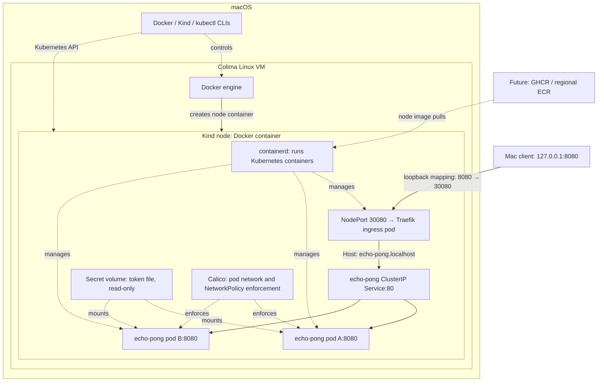

# Echo Pong deployment overview

Local architecture, security boundaries, validation evidence, and the path to
production. Demonstration scripts run from the repository root. Setup instructions
live in [the Kubernetes guide](../k8s/README.md); recorded results live in
[the validation report](../VALIDATION.md).

## Deployment status

The application runs behind an ingress controller with two replicas, restricted
containers, mounted authentication credentials, and enforced network isolation.
Both CPU architectures have been built and tested. Rolling restart availability
and network isolation have been verified through local integration checks. Release automation is the next integration step.

| Demonstrated locally | Still to implement or validate |
| --- | --- |
| Linux ARM64 and AMD64 images and HTTP/CLI smoke tests | GitHub Actions and release gates |
| Non-root, read-only runtime with dropped capabilities | GHCR publication, binary releases, production digest promotion |
| Trivy scans with zero HIGH/CRITICAL findings at validation time | Continuous rescanning as vulnerability data changes |
| Ingress rolling restart: 1,106 requests, zero observed failures | New-version release rollout and rollback automation |
| Positive and negative network controls | Multi-node failure recovery, load tests, cloud deployment |

AMD64 runtime checks used emulation on this ARM64 Mac. A successful scan is a
dated observation, not a permanent statement about an image's vulnerabilities.

## Runtime architecture



- Colima provides the Linux VM needed to run Linux containers on macOS.
- Kind creates a Kubernetes node as a Docker container. Inside that node,
  containerd runs the pod containers; the app is not a standalone Mac process.
- Only the proxy is exposed through the loopback port mapping. The application
  Service stays ClusterIP; it has no public listener or NodePort of its own.
- Calico enforces ingress from the designated Traefik pods and denies all app
  egress, including DNS. This app has no outbound dependencies.
- Image pulls are node operations. Denying app-pod egress does not prevent the
  node from pulling an image; node registry connectivity and credentials remain
  separate requirements. Local images are loaded into Kind and use pull policy
  `Never`.

## Running system

The overview script displays the cluster, workload, endpoint responses, and
security settings. It makes no deployment changes and does not display tokens.
Colima, the cluster, and the app must already be running.

```sh
scripts/demo.sh overview
```

Runtime security includes UID/GID 65532, read-only root filesystem, no Linux
capabilities, no privilege escalation, default seccomp, and no mounted Kubernetes
API token. The authentication token is a separate group-readable Secret volume,
not an image layer or a tracked file. The app reads it at startup, so rotation
requires a coordinated restart; overlapping old/new replicas can accept different
tokens during rotation.

## Availability and isolation

Recorded results are available in [the validation report](../VALIDATION.md).
Live checks are available as separate demo modes:

```sh
scripts/demo.sh rollout
scripts/demo.sh network
```

The rollout mode restarts application pods. The network mode temporarily creates
diagnostic resources and an allow-policy control, then cleans them up. Both target
only the local `kind-echo-pong` cluster. `scripts/demo.sh all` runs the overview,
rollout, and network checks in sequence.

The rollout check sends authenticated requests through Traefik while restarting
the Deployment. It reports observed failures rather than relying on pod status.
The network check first proves its client/destination can communicate, then
checks rejection after policy enforcement. Its egress test uses an actual app
pod's network namespace; testing an unrelated pod would not prove app isolation.

The rollout settings work together:

| Setting | Reason |
| --- | --- |
| Two replicas; `maxUnavailable: 0`, `maxSurge: 1` | Keep existing capacity until a replacement is ready; requires spare resources |
| Startup probe: up to 60 seconds | Preserve the intentional 10-second startup without premature liveness restarts |
| Readiness probe; `minReadySeconds: 5` | Send traffic to ready pods and require a short stable period before rollout advances |
| Kubelet preStop sleep: 10 seconds | Allow endpoint/proxy updates to propagate while the old process still serves |
| SIGTERM drain: up to 20 seconds; grace: 40 seconds | Finish active requests after the preStop delay with room before forced termination |
| Header/read/write/idle timeouts: 5/10/15/60 seconds | Bound slow clients and idle connections |
| Disruption budget | Limit voluntary disruptions; it does not guarantee survival of a node failure |

The Go change is deliberately small: default signal termination could cut off
active requests, so the server now handles SIGTERM/SIGINT and waits for HTTP
shutdown. Race-enabled tests cover actual in-flight request completion and forced
connection closure when the drain deadline expires; vet also passes.

## Image and release design

The builder runs on its native CPU and cross-compiles static Go binaries with
`CGO_ENABLED=0` for Linux AMD64 and ARM64. The compiler image is pinned by digest.
The final scratch image contains the binary, with no shell, package manager, or
runtime libraries. An allowlist in `.dockerignore` keeps credentials and local
files out of the build context. A minimal image still contains Go standard-library
code, so compiler updates and binary vulnerability scanning matter.

The next pipeline should validate pull requests without publishing releases. A
version-tag workflow should build both architectures, scan each, block promotion
on HIGH/CRITICAL findings, publish one multi-platform image index to GHCR, and
attach versioned binary archives and checksums to a GitHub Release. Production
should deploy the approved index digest so each node chooses its architecture
without tags moving underneath the deployment. This workflow is **planned**, not
implemented yet.

Public GHCR publication is the chosen approach, so nodes can pull anonymously.
A private package would protect access to proprietary images, but needs read-only
registry credentials provisioned as an image-pull Secret, referenced by the
service account, and rotated. The app authentication Secret is separate.

## Further discussion

[Technical questions and answers](QUESTIONS_AND_ANSWERS.md) covers the design
choices, scaling strategy, EKS approach, regional image distribution, and retention.
Cloud infrastructure and release automation remain planned.
