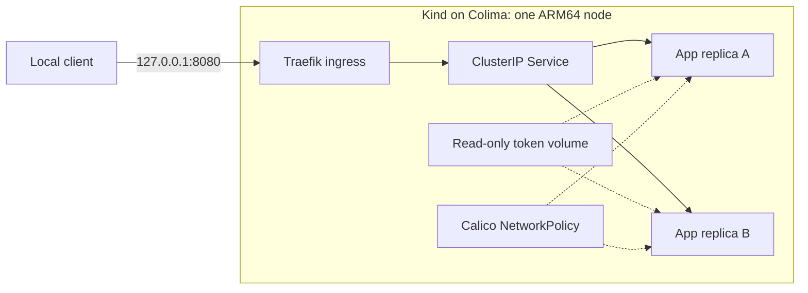

# Start here

Echo Pong is a Go HTTP service and CLI with token authentication. The repository
currently provides secure container builds and a tested local Kubernetes
deployment. CI adds source/security checks and disposable-cluster validation;
release publishing is paused pending the registry visibility decision.

## Review path

1. **Architecture and decisions:** [deployment overview](PRESENTATION.md).
2. **Implementation:** [Dockerfile](../Dockerfile), [Kubernetes base](../k8s/base/),
   and [local environment](../k8s/local/).
3. **Evidence and limits:** [validation report](../VALIDATION.md), including
   commands to reproduce the checks.
4. **Design discussion:** [technical questions and answers](QUESTIONS_AND_ANSWERS.md).
5. **Automation:** [CI checks and publication boundary](CI.md).
6. **Remaining work:** [implementation plan](../IMPLEMENTATION_PLAN.md).

## Architecture at a glance



Only the proxy is exposed through the loopback mapping. Application pods accept
traffic from the designated proxy and have no outbound network access. Node
image pulls are separate from application traffic. The detailed overview explains
Colima, Docker, Kind nodes, and containerd.

## Requirements and evidence

“Verified” means a local check was executed; it does not imply production
certification. Reported results and their scope are recorded in the validation report.

| Requirement | Implementation | Evidence / status |
|---|---|---|
| Non-root containers | [Dockerfile](../Dockerfile), [Deployment](../k8s/base/deployment.yaml) | Application defaults to UID/GID 65532; restricted runtime smoke tests passed |
| Filesystem isolation | [Deployment](../k8s/base/deployment.yaml), [container check](../scripts/check-container.py) | Read-only root filesystem, dropped capabilities, mounted read-only token; verified |
| No committed credentials | [ignore rules](../.gitignore), [secret provisioning](../k8s/README.md#secret-provisioning) | Tokens generated locally and provisioned separately; Full-history CI secret scan passed |
| Image scanning | [image checks](../scripts/check-images.sh) | Both application architectures passed the HIGH/CRITICAL vulnerability gate |
| Prevent vulnerable releases | Local scanner exits on HIGH/CRITICAL findings | CI release promotion gate not implemented yet |
| Rolling availability | [Deployment](../k8s/base/deployment.yaml), [shutdown handling](../main.go), [rollout check](../scripts/check-rollout.py) | Same-image rolling restart: 1,106 requests, zero observed failures |
| Startup and health checks | [Deployment probes](../k8s/base/deployment.yaml) | Both replicas became ready with the intentional 10-second startup delay |
| ARM64 preference | [node affinity](../k8s/base/deployment.yaml) | ARM64 cluster verified; affinity permits AMD64 fallback |
| Ingress/proxy access and isolation | [Ingress](../k8s/components/ingress/), [NetworkPolicy](../k8s/base/network-policy.yaml) | Real ingress access and denied foreign ingress/app egress verified with positive controls |
| Multi-architecture builds | [Dockerfile](../Dockerfile), [image checks](../scripts/check-images.sh) | Linux AMD64/ARM64 built, scanned, and smoke-tested on native CI runners; initial Mac AMD64 checks used emulation |
| GHCR storage and cluster pulls | Visibility undecided; [registry approach](../k8s/README.md#registry-images) | Publication and actual registry pulls pending; local images currently loaded into Kind |
| Versioned container and binary releases | [release plan](../IMPLEMENTATION_PLAN.md#phase-3-cicd-and-releases) | Binary archive/checksum preparation added; tag workflow, published index, and releases pending |
| EKS, scaling, regional distribution, retention | [technical Q&A](QUESTIONS_AND_ANSWERS.md) | Design documented; AWS resources and lifecycle automation not provisioned |

## Quick start and demo

Run from the repository root. Required tools: a running Linux Docker engine,
Kind, kubectl, Helm, curl, and OpenSSL. The overview demo currently also expects
Colima on macOS. Full validation additionally uses Go, Python 3, and Trivy.
The tested local VM has 2 CPUs and 4 GiB RAM; local port 8080 must be available.

This path builds the native image and deploys the local environment. It does not
replace the two-architecture scans and smoke tests in the validation report.

```sh
scripts/local-cluster.sh
docker build -t echo-pong:local .
kind load docker-image echo-pong:local --name echo-pong

kubectl --context kind-echo-pong apply -f k8s/base/namespace.yaml
umask 077
mkdir -p secrets
# Preserve the existing local token on repeat runs.
test -s secrets/token || openssl rand -hex 32 > secrets/token
kubectl --context kind-echo-pong -n echo-pong create secret generic echo-pong-auth \
  --from-file=token=secrets/token --dry-run=client -o yaml |
  kubectl --context kind-echo-pong apply -f -

kubectl --context kind-echo-pong apply -k k8s/overlays/local
kubectl --context kind-echo-pong -n echo-pong rollout status deployment/echo-pong --timeout=180s
scripts/demo.sh overview
```

The overview displays resources, health, rejected unauthenticated access,
authenticated ping, and security settings without printing the token. The
[deployment guide](../k8s/README.md) covers troubleshooting and secret rotation.

Optional live demonstrations:

| Command | Effect |
|---|---|
| `scripts/demo.sh rollout` | Restarts the local Deployment under continuous authenticated ingress traffic |
| `scripts/demo.sh network` | Creates temporary diagnostics to verify policy enforcement, then cleans them up |
| `scripts/demo.sh all` | Runs the overview, rollout, and network checks in sequence |

## Current limits

- The cluster has one node. Replica count and a passing restart check do not prove
  node-failure resilience or a general availability guarantee.
- The rollout test replaces pods using the same image. New-version upgrades,
  rollback, GHCR pulls, and published binary releases remain unverified. CI
  execution status is recorded in the validation report.
- Vulnerability results are point-in-time observations. Release publication must
  re-scan both architectures and block promotion on HIGH/CRITICAL findings.
- Local ingress uses HTTP on loopback. Production TLS, observability, HPA, and
  measured resource sizing remain environment-specific work.
- Cloud deployment is a documented design; no paid AWS resources were created.

Next steps are tracked in [tomorrow’s checklist](TOMORROW.md).
